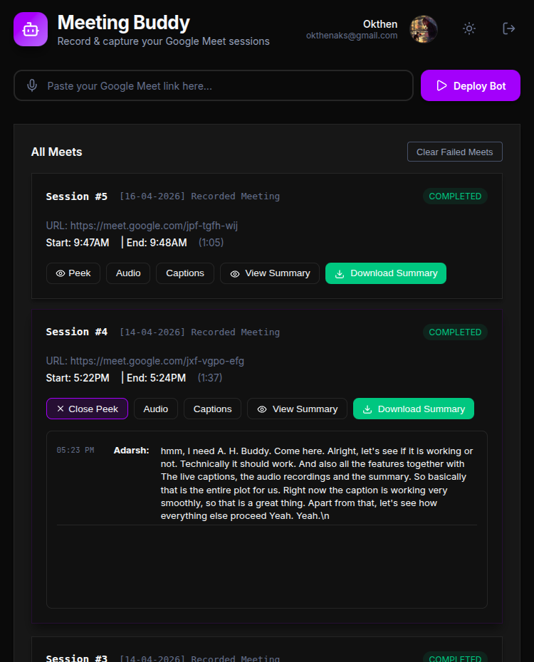
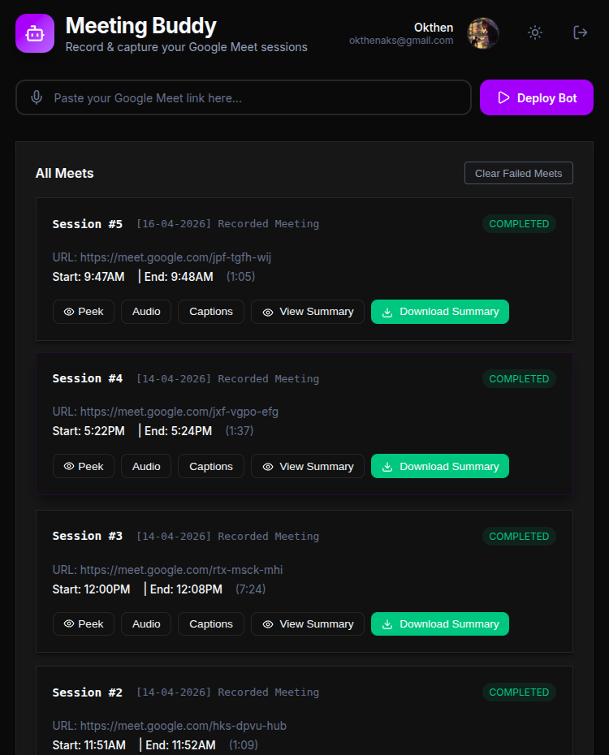
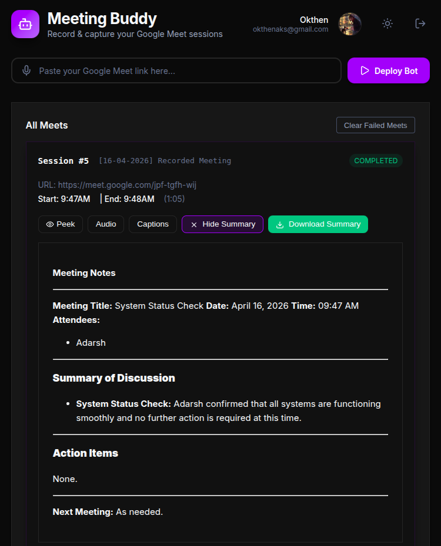

# Meeting Buddy

I built Meeting Buddy because our online club meetings always came with one extra job: writing the minutes of the meeting. We didn't have automatic notes in our Google Meet setup, so someone had to keep track of the conversation, remember who said what, and turn it all into MoMs afterwards.

I wanted to make that easier. What if we could just let a bot join the call, quietly take notes, and leave us with a clear summary once the meeting was over?

That's what Meeting Buddy does. It joins Google Meet, records the audio, and collects captions with participant names. Afterwards, it uses both to put together notes covering the discussion, decisions, and action items, with context about who said what.

<p align="center">
  <a href="assets/meeting-buddy-captions.png">
    
  </a>
</p>

## From a meeting link to meeting notes

Sign in with Google, paste the meeting link, and click **Deploy Bot**. Meeting Buddy opens the call in its own browser session, enters its name, and asks to join. The host admits it just like any other guest; your dashboard login doesn't sign the bot into the meeting.

Once admitted, it turns off its microphone and camera and starts recording. Google Meet's captions provide the conversation text and participant names, while the audio gives the summarizer another source to work from. You can open **Peek** to see the captions coming in without leaving the dashboard.

When the meeting ends, the bot saves the recording and exits. You can also stop it from the dashboard. The session stays in your history, with the audio and captions available to download.

Click **Generate Notes** on a finished session to create the summary. This is currently a separate step after recording. The notes open right inside the dashboard, and you can download them as a Markdown file to keep or share with the club.

<table>
  <tr>
    <th>Dashboard</th>
    <th>Meeting notes</th>
  </tr>
  <tr>
    <td width="50%" valign="top"><a href="assets/login_view.png"></a></td>
    <td width="50%" valign="top"><a href="assets/meeting-buddy-summary.png"></a></td>
  </tr>
</table>

*An example from a short test call, showing the discussion summary and action items.*

## Why keep both audio and captions?

Audio helps capture the conversation, but a transcript alone doesn't necessarily tell you the participants' real names. Meet's captions carry those names, so the summarizer can compare the two sources and try to connect each speaker to what they said.

The aim is to give us something useful after the call: what was discussed, what was decided, and who needs to do what next. The original audio and captions remain available when a detail needs checking. Attribution still depends on the quality of those inputs, so speaker names aren't guaranteed to be perfect.

## Multiple people, multiple meetings

Multiple signed-in users can launch their own bots at the same time. So if two or three people have different meetings to attend, each can send a Meeting Buddy to their call. Their meeting history and downloads are tied to their own account.

Each meeting runs in a separate Python process with its own Chrome session, browser profile, recording folder, and virtual audio sink. **PulseAudio and FFmpeg** keep the audio recordings separate, so one bot's meeting doesn't end up in another bot's recording. The number of bots a host can run depends on its available resources.

## What it's built with

The dashboard is built with **React and Vite**, with a **FastAPI** backend handling sign-in verification, meeting sessions, and downloads. **Selenium** and `undetected-chromedriver` handle the browser interactions needed to join Google Meet and read its captions.

For the cloud setup, **Xvfb** provides a virtual display so Chrome can run on **AWS** without a physical monitor while Selenium still interacts with the meeting page. PulseAudio provides a virtual audio output, and FFmpeg records from that output's monitor stream. **SQLite** keeps track of which meetings belong to each signed-in user.

For notes, **Mistral's Voxtral** transcribes the recorded audio and separates speakers. **Mistral Small** then combines that transcript with the captions to produce the final Markdown notes. Recording files are stored on the host; generating notes sends the audio and text to Mistral's hosted API.

## Running locally

The recording side is built for **Linux**, with Chrome or Chromium, FFmpeg, and a working PulseAudio-compatible audio service. You'll also need Python 3.12, Node.js 20.19+ or 22.12+, a Google OAuth web client ID, and a Mistral API key for notes.

<details>
<summary><strong>Local setup and startup commands</strong></summary>

From the repository root, install the backend dependencies:

```bash
python3 -m venv .venv
source .venv/bin/activate
pip install setuptools
pip install -r requirements.txt
```

Create a root `.env` file:

```dotenv
GOOGLE_CLIENT_ID=your-client-id.apps.googleusercontent.com
MISTRAL_API_KEY=your-mistral-api-key
```

Create `frontend/.env` using the same Google client ID:

```dotenv
VITE_GOOGLE_CLIENT_ID=your-client-id.apps.googleusercontent.com
VITE_API_URL=http://localhost:8000
```

Add `http://localhost:5173` as an authorized JavaScript origin in your Google OAuth client settings. Keep the Mistral key in the root environment file; frontend environment values are public.

There's one deployment-specific path to change before launching a bot: in `app.py`, replace `/home/ubuntu/Meeting-Buddy/.venv/bin/python` with the absolute path to your checkout's `.venv/bin/python`.

Start the backend from the repository root:

```bash
source .venv/bin/activate
uvicorn app:app --host 127.0.0.1 --port 8000
```

In a second terminal, start the frontend:

```bash
cd frontend
npm ci
npm run dev
```

Open **http://localhost:5173**. Chrome needs a display; on a server without one, run the backend under Xvfb. `pactl info` should succeed as the user running the backend before you start a recording.

</details>

## A few practical limits

The bot needs guest admission and stops recording after two hours. Its browser automation relies on Google Meet's interface and caption selectors, so UI changes can affect joining or caption capture. This version expects the English meeting controls and runs on a single Linux host.

## Dev Notes

Hey people, this project Meeting Buddy was as take-home interview project(didn't took the intership, they were paying pennies), but it was a lot of fun to build. I learned plenty along the way, especially about backend development, running chrom on aws without a physical display, and using multiprocessing to run several bots at once. Getting the virtual display and audio capture working together took a fair bit of jugaad, and figuring those things out was one of my favourite parts of the project.. anyways that's for stopping by.. 

~ Kr-Adarsh
